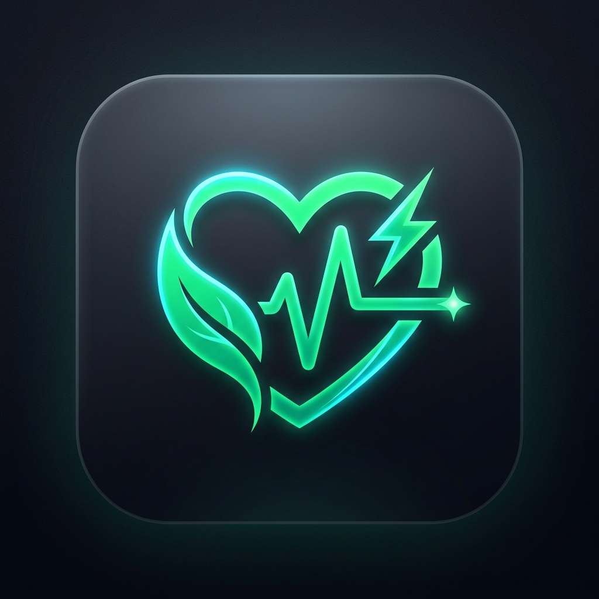

# 🚀 FitPulseAI — Guia de Melhorias, Inovações e Futuro do App

  
  <h3>FitPulseAI • O Futuro da Nutrição e Treino Inteligente</h3>

---

## 🌟 Visão Geral
O **FitPulseAI** já conta com uma base sólida (Scanner Multimodal TACO/USDA, Chat com PulseBot 2.0 Flash, Diário Nutricional e Treinos). Abaixo está a lista com as **melhores ideias e inovações** para levar o aplicativo ao nível dos apps líderes de mercado mundial (como MyFitnessPal, Whoop, Hevy e MacroFactor).

---

## 🧠 1. Inteligência Artificial Avançada (Next-Gen AI)

### 📸 Scanner de Código de Barras Instantâneo (Barcode Scan)
- Leitor de código de barras com câmera nativa integrado à API **Open Food Facts Brasil**.
- Leitura instantânea de alimentos industrializados (tabela nutricional exata do fabricante nacional).

### 🎙️ Diário por Áudio & Comandos de Voz ("PulseVoice")
- Permitir que o usuário apenas fale: *"Comi 200g de arroz com 150g de frango e tomei 500ml de água"*.
- A IA transcreve, calcula os macros e já adiciona automaticamente ao log sem precisar digitar.

### 🍽️ Gerador Inteligente de Cardápios & Receitas
- A IA sugere receitas completas baseadas estritamente nos **ingredientes que o usuário tem na geladeira** e nos **macros que faltam** para bater a meta do dia.

### 🔮 Previsão de Resultados com IA (Metabolic Forecasting)
- Estimativa preditiva: *"Mantendo essa consistência calórica e de treinos, você atingirá sua meta de 70kg em 42 dias"*.

---

## 🏋️‍♂️ 2. Treinos, Exercícios & Fisiologia

### ⏱️ Modo "Treino Ativo" com Timer de Descanso Automático
- Cronômetro flutuante de descanso entre séries com bip sonoro/vibração.
- Sugestão de carga progressiva baseada no histórico da semana anterior (Overload Progressivo).

### 🎥 Análise de Execução por Câmera (Computer Vision Form Check)
- Usar a câmera do celular para detectar postura em exercícios básicos (ex: agachamento, levantamento terra) e dar feedback de amplitude.

### 📅 Periodização Automática de Treino
- A IA monta divisões completas (Push/Pull/Legs, Upper/Lower, ABCDE) ajustando volume conforme nível de cansaço e recuperação reportados.

---

## ⌚ 3. Integrações & Wearables (Conectividade Total)

### 🏃‍♂️ Smartwatches & Sensores de Saúde
- **Google Health Connect & Apple Health:** Sincronização direta de passos, frequência cardíaca, sono e calorias queimadas ativas.
- **Garmin & Strava:** Importação detalhada de altimetria, pace, zonas de frequência cardíaca e gasto calórico real.

### ⚖️ Balanças Inteligentes (Bluetooth Scale)
- Leitura direta de % de gordura, água corporal e massa magra via Bluetooth BLE.

---

## 🎮 4. Gamificação, Social & Engajamento

### 🏆 Sistema de Níveis & Ligas Semanais (Estilo Duolingo)
- Divisões de bronze, prata, ouro e diamante com base em consistência de água, bater macros e treinos concluídos.
- Recompensas visuais exclusivas (badges 3D, skins de avatar, temas especiais).

### 👥 Desafios em Grupo com Amigos
- Desafio de 30 dias de hidratação ou corte calórico em grupo com ranking compartilhado em tempo real.

### 📸 Compartilhamento nos Stories (Instagram/WhatsApp)
- Gerador de cards elegantes e prontos para stories com o resumo do treino ou macros do dia ("Hoje foi pago! 💪🔥").

---

## 🎨 5. Design, UX & Performance

### ⚡ Modo Offline Completo (PWA Cache First)
- Permitir registrar refeições e treinos mesmo sem sinal de internet, sincronizando com a nuvem assim que a conexão voltar.

### 📱 Widgets para a Tela Inicial do Celular
- Widget de progresso de água (botão de +250ml direto na home do Android).
- Widget de barra de progresso de calorias e macros restantes no dia.

### 🌙 Temas Visuais Personalizados (Cyberpunk, OLED Black, Midnight Purple)
- Paletas de cores refinadas para dar uma experiência visual de altíssimo padrão.

---

## 📋 Tabela de Prioridades Recomendadas

| Funcionalidade | Impacto | Esforço | Prioridade |
|---|---|---|---|
| **Leitor de Código de Barras (Barcode)** | 🔥 Altíssimo | Médio | **Fase 1 (Imediata)** |
| **Comando de Voz para Refeições** | 🔥 Altíssimo | Baixo/Médio | **Fase 1 (Imediata)** |
| **Widgets Android (Água e Macros)** | ⚡ Alto | Médio | **Fase 2** |
| **Timer de Descanso Ativo no Treino** | ⚡ Alto | Baixo | **Fase 2** |
| **Gerador de Cardápio com IA** | ⚡ Alto | Baixo | **Fase 2** |
| **Integração Google Health Connect** | 💎 Muito Alto | Alto | **Fase 3** |
| **Sistema de Ligas & Desafios** | 💎 Muito Alto | Alto | **Fase 3** |
